# Flussi di node-smartcard

Questo documento descrive i flussi implementati, non una proposta architetturale.
I diagrammi Mermaid seguono i metodi del codice corrente, inclusi code,
ownership, percorsi di errore e chiusura. Uso dell'API ed esempi sono nel
[README](./README.md).

Verifica sul codice: **3 novembre 2026**.

Il pacchetto e' indipendente da node-cryptoki e dal riferimento node-scard.
Il riferimento definisce l'API high-level; node-ctypes fornisce il binding nativo.
L'import costruisce i tipi e carica node-ctypes, ma non apre la libreria PC/SC:
questa viene aperta in `Native` oppure durante `Context.establish()`.

## Indice

1. [Architettura a livelli](#1-architettura-a-livelli)
2. [ABI e stringhe](#2-abi-e-stringhe)
3. [Caricamento, dispatch low-level ed errori](#3-caricamento-dispatch-low-level-ed-errori)
4. [Contesti e handle pubblici](#4-contesti-e-handle-pubblici)
5. [Concorrenza, attesa e cancellazione](#5-concorrenza-attesa-e-cancellazione)
6. [Carte, transazioni e scambio dati](#6-carte-transazioni-e-scambio-dati)
7. [Chiusura e retry](#7-chiusura-e-retry)
8. [Monitor ed eventi](#8-monitor-ed-eventi)
9. [ATR e compatibilita](#9-atr-e-compatibilita)
10. [Verifica e pacchetto](#10-verifica-e-pacchetto)
11. [Riferimenti al codice](#riferimenti-al-codice)

## 1. Architettura a livelli

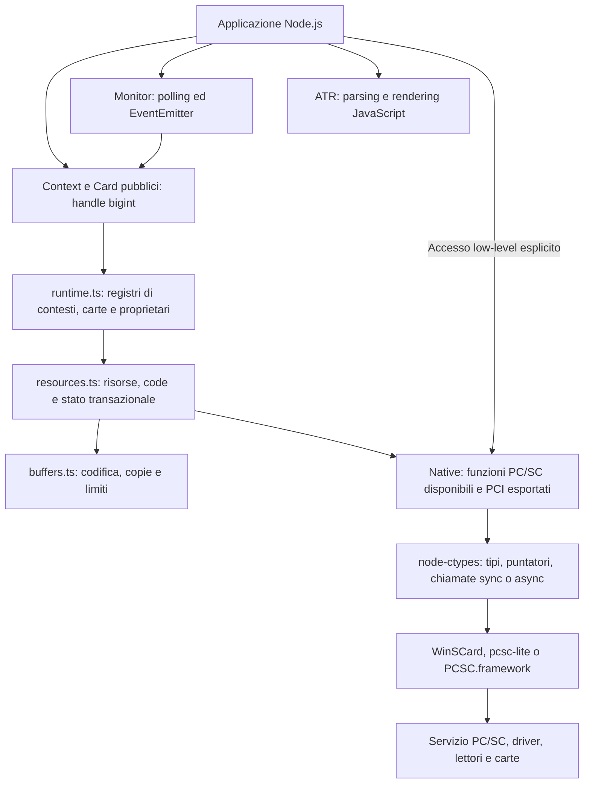

Il namespace high-level `scard` e il suo alias `smartcard` sono lo stesso oggetto
congelato. Gli export nominati includono anche `SCardError` e `Delay`, che non
sono membri di quel namespace. `node-smartcard/scard` riesporta l'entry point
principale; `node-smartcard/low-level` espone invece i tipi ctypes, le costanti C
e `Native`, anche attraverso un proprio namespace `scard`.

Le classi di [resources.ts](./src/resources.ts) sono interne: l'API pubblica
handle-based e' quella di [runtime.ts](./src/runtime.ts). Opzioni interne come
`WaitOptions.signal`, il prestito di `Native` e `TransmitOptions.responseCapacity`
non sono parametri delle corrispondenti firme pubbliche.

| File                                                                                               | Responsabilita'                                                        |
| -------------------------------------------------------------------------------------------------- | ---------------------------------------------------------------------- |
| [src/index.ts](./src/index.ts), [src/scard.ts](./src/scard.ts)                                     | Export pubblici, namespace e versione                                  |
| [src/runtime.ts](./src/runtime.ts)                                                                 | API handle-based compatibile con node-scard e registri dei proprietari |
| [src/resources.ts](./src/resources.ts)                                                             | Risorse native, code, chiusura e attese                                |
| [src/constants.ts](./src/constants.ts), [src/types.ts](./src/types.ts)                             | Enum high-level e DTO                                                  |
| [src/atr.ts](./src/atr.ts)                                                                         | Parser ATR e rendering                                                 |
| [src/monitor.ts](./src/monitor.ts)                                                                 | EventEmitter per lettori e carte                                       |
| [src/buffers.ts](./src/buffers.ts)                                                                 | Codifiche, limiti, letture dimensionate                                |
| [src/low-level/types.ts](./src/low-level/types.ts)                                                 | Tipi scalari, puntatori e strutture ctypes                             |
| [src/low-level/native.ts](./src/low-level/native.ts)                                               | Caricamento, firme e PCI esportati                                     |
| [src/low-level/constants.ts](./src/low-level/constants.ts), [errors.ts](./src/low-level/errors.ts) | Costanti native, codici ed errori                                      |

## 2. ABI e stringhe

Le scelte derivano dai tipi degli header WinSCard, pcsc-lite e Apple:

| Elemento                 | Windows                       | Linux pcsc-lite      | macOS PCSC.framework |
| ------------------------ | ----------------------------- | -------------------- | -------------------- |
| Convenzione              | WinDLL / stdcall              | CDLL / cdecl         | CDLL / cdecl         |
| DWORD                    | uint32                        | unsigned long nativo | uint32               |
| LONG                     | int32                         | long nativo          | int32                |
| Context/card handle      | intero unsigned pointer-sized | LONG                 | int32                |
| SCARD_READERSTATE.rgbAtr | 36 byte                       | 33 byte              | 33 byte              |
| Packing strutture        | naturale                      | naturale             | 1                    |
| Testo                    | UTF-16LE, funzioni W          | UTF-8                | UTF-8                |

`createTypes(platform)` permette l'ispezione del modello, ma `c_long` e
`c_ulong` restano quelli del processo corrente: non e' un emulatore di un altro
target. `Native` rifiuta tipi di una piattaforma diversa dall'host.

`SCARD_IO_REQUEST` contiene due DWORD. I PCI T0, T1 e RAW vengono risolti con
`in_dll`; un simbolo mancante causa errore, non un fallback silenzioso.
`SCARD_AUTOALLOCATE` usa tutti i bit del DWORD nativo; `INFINITE` resta 0xffffffff.
Le costanti RAW, stato della carta e unsupported-feature dipendono dall'OS.
`SCARD_CTL_CODE` applica la formula della piattaforma.

I nomi high-level devono essere stringhe Unicode valide, non vuote e senza NUL.
Le liste non vuote richiedono un multi-string terminato da due NUL; un buffer
di lista vuoto produce `[]`.
`SCardStatus` accetta anche il singolo terminatore usato da implementazioni Unix.
Un nome vuoto o una codifica non valida viene rifiutato.

Fonti: `createTypes` in [low-level/types.ts](./src/low-level/types.ts),
`platformConstants`, `currentPlatform`, `SCARD_CTL_CODE` in
[low-level/constants.ts](./src/low-level/constants.ts), `text`, `multiString`,
`statusNames` in [buffers.ts](./src/buffers.ts).

## 3. Caricamento, dispatch low-level ed errori

### Caricamento della libreria

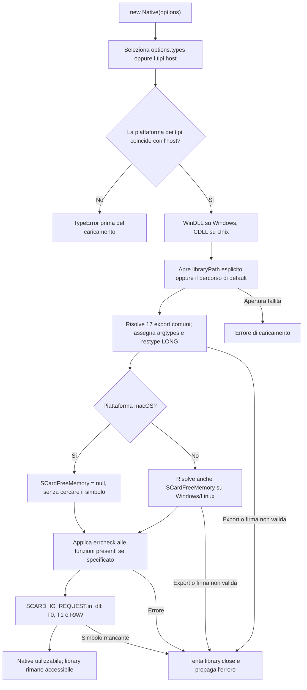

I percorsi predefiniti sono `winscard.dll`, `libpcsclite.so.1` e
`/System/Library/Frameworks/PCSC.framework/PCSC`. Non c'e' ricerca di librerie
alternative dopo un errore. Un fallimento durante binding o risoluzione dei PCI
tenta di chiudere la libreria gia' aperta.

Sono esposte 17 funzioni comuni, piu' SCardFreeMemory su Windows/Linux:

- SCardEstablishContext, SCardReleaseContext, SCardIsValidContext;
- SCardListReaders, SCardListReaderGroups;
- SCardConnect, SCardReconnect, SCardDisconnect;
- SCardBeginTransaction, SCardEndTransaction;
- SCardStatus, SCardGetStatusChange, SCardCancel;
- SCardTransmit, SCardControl, SCardGetAttrib, SCardSetAttrib;
- SCardFreeMemory: wrapper su Windows/Linux, null su macOS.

PCSC.framework non esporta SCardFreeMemory: il binding non ne tenta la
risoluzione su macOS. Il tipo nullable impone al chiamante low-level un controllo
prima dell'uso; non viene sostituita da uno stub o da free della libc.
Gli altri export rimangono obbligatori. La presenza della costante
SCARD_AUTOALLOCATE non garantisce il supporto nativo all'autoallocazione.

Su macOS il nome canonico SCardControl risolve SCardControl132, come la macro
dell'header Apple: e' la variante a sette argomenti. L'export legacy SCardControl
ha cinque argomenti e non e' compatibile con quella firma.

I nomi canonici delle funzioni testuali selezionano i simboli W su Windows.
La libreria ctypes originale rimane disponibile come `native.library`.
I wrapper sono ottenuti tramite accesso agli attributi della CDLL/WinDLL:
`argtypes`, `restype` ed `errcheck` sono accessor reali, non metadati decorativi.
Il cast TypeScript locale restringe solamente la firma del wrapper dinamico.

### Chiamata e traduzione del risultato

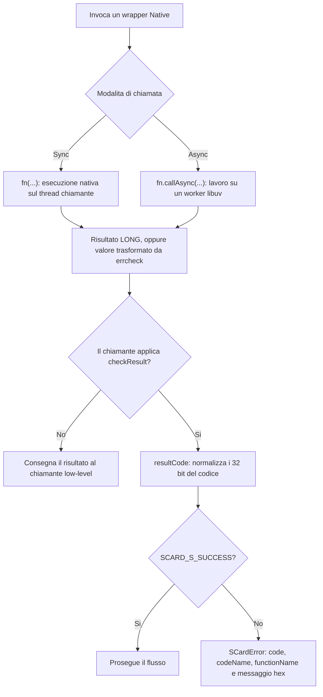

Senza trasformazioni `errcheck`, i risultati sono `number | bigint`.
Non c'e' errcheck automatico salvo opzione esplicita.
`checkResult()` normalizza il risultato a uint32 e genera `SCardError` con
`code`, `codeName`, `functionName` e messaggio esadecimale.

Il caller low-level possiede handle, memoria ed eventuali allocazioni native.
`close()` e' idempotente, ma node-ctypes rifiuta la chiusura durante chiamate
pendenti. Le viste `in_dll` possono differire lo scaricamento fisico.
Il livello high-level usa `checkResult` e gestisce esplicitamente le eccezioni
attese: insufficienza del buffer, assenza di lettori e timeout delle slice.
Un timeout finale e gli altri codici non ammessi vengono propagati.

Fonti: `defaultLibraryPath`, `bind`, `Native.constructor`, `Native.close` in
[native.ts](./src/low-level/native.ts); `resultCode`, `checkResult`, `SCardError`
in [errors.ts](./src/low-level/errors.ts).

## 4. Contesti e handle pubblici

```mermaid
sequenceDiagram
    participant App as Applicazione
    participant Pub as Context pubblico
    participant Res as Context interno
    participant N as Native e PC/SC
    participant Reg as Registri e ownership
    App->>Pub: new Context()
    Note over Pub: Nessun handle o accesso PC/SC nel costruttore
    App->>Pub: establish(scope)
    Pub->>Pub: Rifiuta durante dispose e valida uint32
    Pub->>Res: establish con scope
    Res->>Res: Valida scope e crea Native e scalare handle
    Res->>N: SCardEstablishContext.callAsync(...)
    Pub->>Pub: Traccia la Promise in pending
    alt Successo nativo
        N-->>Res: SCARD_S_SUCCESS e handle
        Res-->>Pub: Risorsa con coda vuota e Native posseduto
        Pub->>Reg: Registra handle, risorsa e funzione remove del proprietario
        Pub-->>App: bigint
    else Errore nativo
        N-->>Res: Codice di errore o rigetto
        Res->>N: Chiude Native se posseduto
        Res-->>Pub: Errore
        Pub-->>App: Promise rigettata
    end
    Note over Pub: finally rimuove la Promise da pending
```

Un oggetto `Context` puo' stabilire piu' contesti. Il registro del modulo associa
gli handle alle risorse, e il proprietario tiene gli handle ancora da rilasciare.
Un altro wrapper puo' operare su un handle gia' registrato, come nell'API nativa;
gli handle esterni al registro non vengono adottati implicitamente.

`contextEntry` e `cardEntry` accettano solo bigint presenti nei rispettivi
registri: un tipo errato produce `TypeError`, un handle sconosciuto produce
`SCardError(SCARD_E_INVALID_HANDLE)`. Non adottano handle low-level esterni.

### Enumerazione dei lettori e output dimensionati

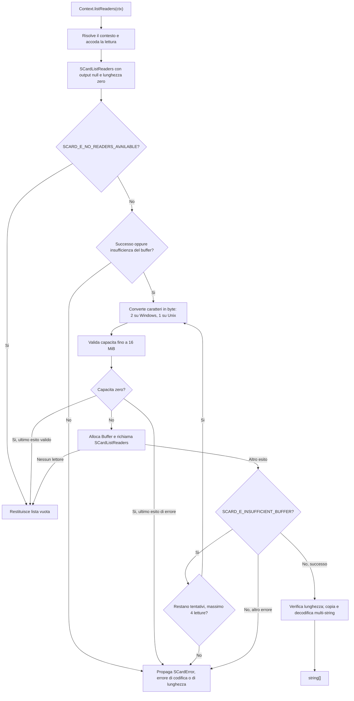

`listReaders(ctx)` restituisce stringhe; `SCARD_E_NO_READERS_AVAILABLE` diventa
`[]` sia nella query delle dimensioni sia nella lettura. Gli altri errori
vengono propagati. `readBuffer` effettua una query e al massimo quattro letture;
`Card.getAttribute` usa lo stesso helper, ma senza tradurre l'assenza di lettori
in un risultato vuoto.

La disposizione automatica aspetta gli establish pendenti e rilascia gli handle
in ordine inverso. Le richieste establish durante la disposizione sono rifiutate.
I fallimenti di cleanup vengono raccolti in AggregateError; gli handle falliti
rimangono posseduti per un nuovo tentativo.

Non esiste un finalizer che prometta cleanup deterministico: usare `await using`
oppure `release(ctx)` esplicito.

Fonti: `Context.establish`, `contextEntry`, `cardEntry`, `Context.listReaders`
in [runtime.ts](./src/runtime.ts); `Context.establish`, `Context.listReaders`
in [resources.ts](./src/resources.ts); `readBuffer`, `multiString`
in [buffers.ts](./src/buffers.ts).

## 5. Concorrenza, attesa e cancellazione

### Code e lavori concorrenti

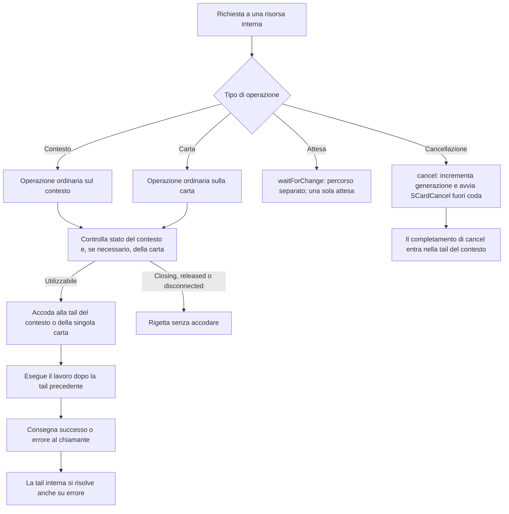

Le operazioni ordinarie del contesto usano una coda; ciascuna carta ha una coda
separata. Le attese non occupano la coda del contesto, e `cancel()` esegue la
chiamata fuori da essa. Il completamento di cancel viene comunque tracciato
prima della chiusura della libreria.

Le guardie di `runContext` e `runCard` vengono applicate prima dell'accodamento,
non ripetute automaticamente all'inizio del lavoro. Le operazioni gia' ammesse
vengono drenate durante il rilascio. La tail interna assorbe il rigetto solo
per permettere ai lavori successivi di partire: la Promise dell'operazione
restituita al chiamante conserva l'errore.

### Normalizzazione dell'input e attesa degli stati

`getStatusChange(ctx, input, timeout)` conserva la firma del riferimento:

- input vuoto: enumera tutti i lettori; nessun lettore restituisce `[]`;
- stringhe: nomi con stato iniziale Unaware;
- numeri: indici non negativi nell'elenco attuale;
- Status: riusa reader e state.value; copia i valori prima dell'attesa.
  Richiede anche un ATR di tipo Buffer, ma l'ATR e state.name non vengono
  inviati alla funzione nativa come criteri di confronto.

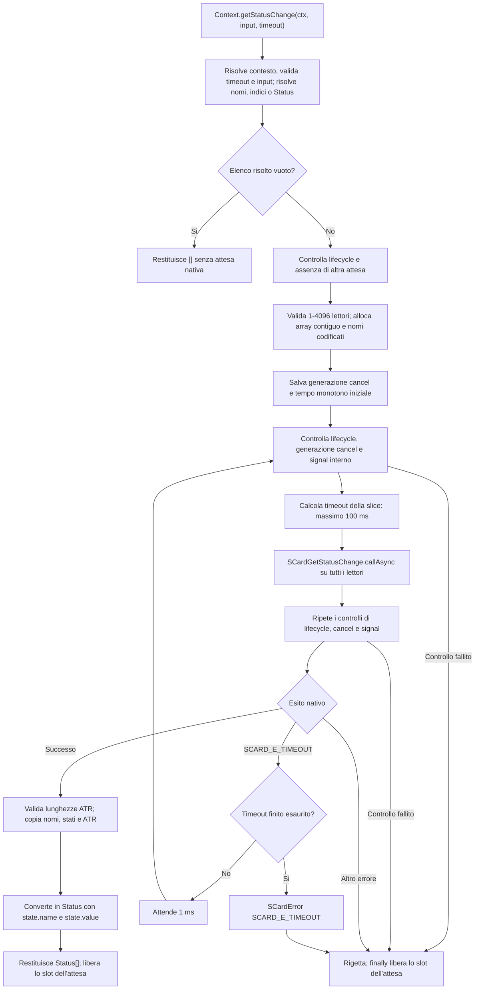

L'array contiene fino a 4096 lettori e mantiene vivi i buffer dei nomi fino al
completamento. Il timeout richiesto a ogni chiamata nativa e' al massimo 100 ms:
non e' una garanzia sulla durata reale della chiamata o sull'attesa di un worker.
La deadline usa un clock monotono. Lo stato corrente non viene sovrascritto
fra le slice. Il timeout `0xffffffff` non ha una deadline totale.

Timeout zero esegue comunque una prima query nativa con timeout zero:
puo' restituire subito uno stato oppure rigettare con `SCARD_E_TIMEOUT`.
L'assenza di lettori risolta dalla facciata restituisce invece subito `[]`,
anche con un timeout infinito.

### Cancellazione e arresto dell'attesa

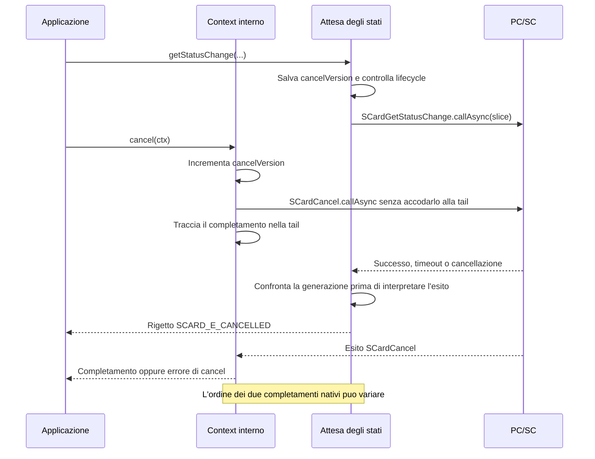

E' ammessa una sola attesa per contesto. `cancel()` incrementa anche una
generazione JS, per non perdere la cancellazione fra due slice: l'attesa
con una generazione precedente rigetta con SCARD_E_CANCELLED.
La chiamata nativa a SCardCancel e' comunque asincrona: attenderne il completamento
prima di iniziare una nuova attesa evita la sovrapposizione con quel cancel
nativo ancora in corso. Il contatore JS non isola chiamate native concorrenti.
La release marca il contesto come closing, impedisce nuovi lavori e aspetta che
l'attesa termini prima di rilasciare risorse native. Non invoca SCardCancel:
la slice pendente termina e il successivo controllo del lifecycle rigetta
l'attesa con l'errore locale di contesto closing, non necessariamente CANCELLED.

Le chiamate native occupano worker libuv. Le code non coordinano processi esterni
o utilizzi low-level indipendenti. Un driver bloccato o una transazione nativa
in attesa puo' comunque ritardare cleanup: non e' previsto un timeout forzato
che abbandoni puntatori ancora usati dal C.

Fonti: `enqueue`, `runContext`, `runCard`, `Context.waitForChange`,
`Context.cancel`, `Context.release` in [resources.ts](./src/resources.ts);
`Context.getStatusChange` in [runtime.ts](./src/runtime.ts);
`stateName` in [constants.ts](./src/constants.ts).

## 6. Carte, transazioni e scambio dati

### Connessione e registrazione della carta

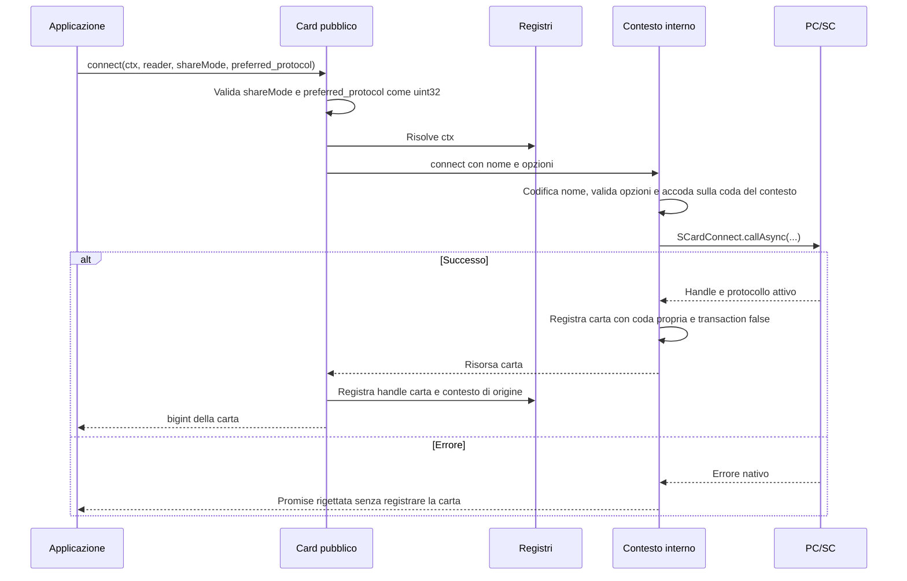

`Card.connect(ctx, reader, shareMode, preferred_protocol)` registra un handle
bigint e il protocollo negoziato. `reconnect(handle, ...)` restituisce lo stesso
handle e aggiorna il protocollo. `status(handle)` restituisce esattamente:

```typescript
{
  reader: string;
  activeProtocol: {
    name: string;
    value: number;
  }
  atr: Buffer;
}
```

### Stato e attributi

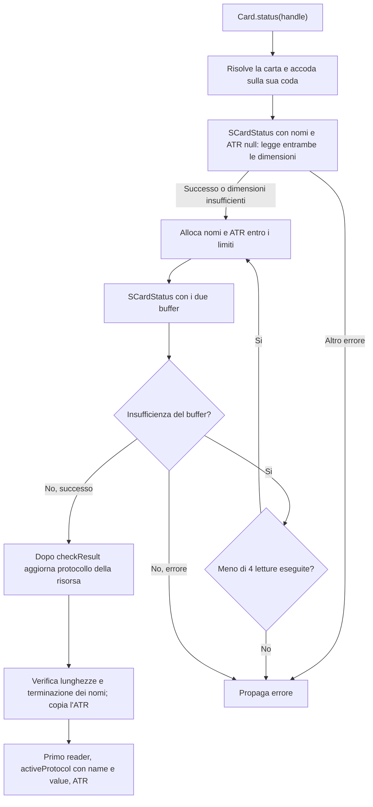

La risorsa conserva anche la lista completa dei nomi e lo stato nativo della
carta; la facciata pubblica restituisce soltanto il primo nome, il protocollo
attivo e l'ATR. `protocolName` traduce il protocollo nel nome del DTO.
`getAttribute` usa `readBuffer` con SCardGetAttrib e non interpreta il valore.

### Transazioni e reconnect

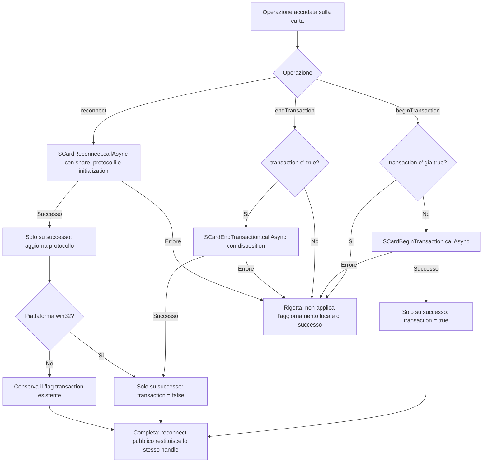

`beginTransaction`/`endTransaction` sono aggiunte: rifiutano stato locale
incoerente e non implementano nesting o un lock fra task JavaScript concorrenti.
I controlli sul flag sono dentro il lavoro accodato. Usarle sequenzialmente e
terminare in `finally`. Il flag locale non rileva da solo reset o modifiche
esterne alla risorsa.

Un reconnect riuscito azzera il flag su Windows; sulle altre piattaforme il
codice conserva il valore precedente. Questo modella la diversa durata delle
transazioni WinSCard e PC/SC Unix. Un reconnect fallito non modifica il
protocollo o lo stato transazionale locale. La verifica runtime dei rami Unix
richiede quei sistemi.

### Trasmissione, control e scrittura degli attributi

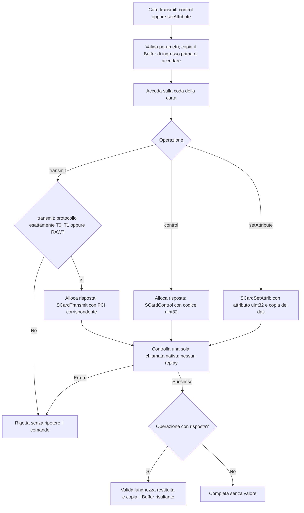

`transmit(handle, command, preferred_protocol)` conserva l'argomento protocollo
del riferimento. Sono selezionati PCI T0, T1 o RAW; un protocollo non supportato
viene rifiutato prima della chiamata nativa, dentro il lavoro accodato.
Non seleziona automaticamente il protocollo memorizzato nella risorsa e non
accetta `Tx` come sostituto del protocollo effettivo. Per connessioni Direct
usare `control`.

La risposta APDU ha capacita' 65.538 byte, non il limite di 258 dell'esempio
iniziale. Le risposte includono SW1/SW2 senza interpretarli. Non c'e' retry su
insufficient-buffer o errore: ripetere una APDU potrebbe duplicare effetti.
Lo stesso vale per `control()` e `setAttribute()`.
`control` usa 4096 byte di risposta come default e permette una capacita'
esplicita nell'API pubblica. `transmit` usa 65.538 byte nell'API pubblica;
l'opzione per cambiarla appartiene alla risorsa interna. Un comando transmit
vuoto e' rifiutato; control e setAttribute accettano anche Buffer vuoti.

Liste, attributi e stato possono ripetere solo letture: prima interrogano le
dimensioni, poi eseguono al massimo quattro letture dei buffer, gestendo
insufficient-buffer. Le capacita' dei buffer gestiti sono limitate a 16 MiB;
non e' un limite globale della memoria del processo. Una lunghezza
restituita oltre la capacita' genera RangeError. Comandi e attributi in ingresso
vengono copiati prima dell'accodamento; gli output consegnati possiedono copie.

`getAttribute` conserva la dichiarazione del riferimento
`Promise<Buffer | string | number>`; l'implementazione nativa consegna Buffer.

### Memoria diretta e mirrored

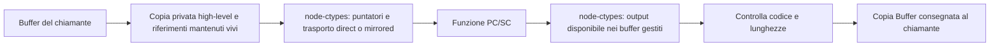

La modalita' dei buffer e' gestita da node-ctypes, non da un ramo alternativo
di node-smartcard. I test mirrored impostano `NODE_CTYPES_NO_EXTERNAL_BUFFERS=1`.
Le copie high-level rimangono in entrambe le modalita'. Per le attese, l'array
SCARD_READERSTATE e i buffer dei nomi restano referenziati per tutta l'operazione;
per transmit i PCI sono viste `in_dll` mantenute dal relativo Native.
Il livello gestito usa Buffer e non SCARD_AUTOALLOCATE: non deve chiamare
SCardFreeMemory per liberare questi output. Le allocazioni native richieste
dal chiamante low-level rimangono invece di sua competenza.

Fonti: i metodi di `Card` in [runtime.ts](./src/runtime.ts) e
[resources.ts](./src/resources.ts); `inputBytes`, `capacity`, `returnedLength`,
`statusNames`, `readBuffer` in [buffers.ts](./src/buffers.ts);
`protocolName` in [constants.ts](./src/constants.ts);
[test-mirrored.ts](./scripts/test-mirrored.ts).

## 7. Chiusura e retry

### Rilascio di un contesto

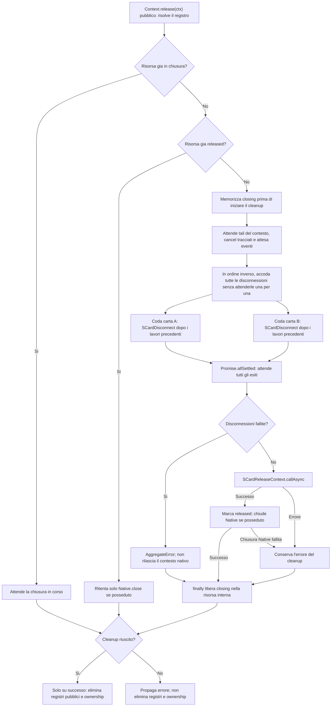

Il diagramma espande due carte; il codice applica `Promise.allSettled` a tutte
le carte del contesto. Non significa che le funzioni native finiscano in ordine
inverso: quello e' l'ordine di accodamento, non di completamento.

`disconnect()` imposta `disconnecting` prima di attendere la propria coda.
Solo dopo il successo nativo marca `disconnected`, azzera `transaction` e
rimuove la carta dall'insieme della risorsa contesto; la facciata rimuove poi
l'handle dal registro pubblico. Un errore non viene
stampato e ignorato come nell'esempio originale: viene rigettato e la risorsa
resta disponibile per il cleanup. Una release riuscita invalida anche tutte le
carte gestite collegate. Handle pubblici gia' rimossi producono invalid-handle.
Le risorse interne rendono idempotenti disconnect e release; le facciate
pubbliche rigettano invece un handle gia' eliminato dal registro.

Le disconnessioni procedono tramite le code separate delle carte: una connessione
in attesa di `beginTransaction` non deve impedire di disconnettere la connessione
che possiede la transazione. Tutti gli esiti vengono raccolti prima di rilasciare
il contesto; eventuali errori restano aggregati e ritentabili.

Un cleanup parziale non annulla disconnessioni gia' riuscite. Le loro risorse
sono gia' chiuse, anche se la facciata mantiene i registri fino al successo
complessivo della release. Se fallisce solo `Native.close` dopo la release
nativa, la risorsa resta `released`: un retry ritenta la chiusura di Native,
senza ripetere SCardReleaseContext.

### Disposizione del proprietario pubblico

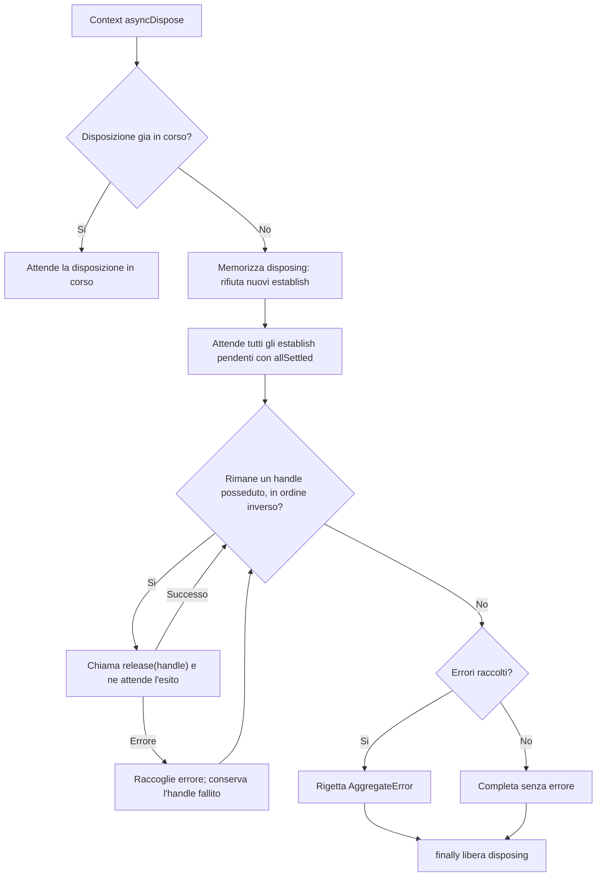

La disposizione di piu' contesti e' sequenziale; le disconnessioni delle carte
di ciascun contesto sono invece avviate insieme. I fallimenti degli establish
restano sulle rispettive Promise: `allSettled` serve ad aspettarne gli effetti,
non a convertirli in successi o ad aggiungerli agli errori di release.
La disposizione non imposta un flag permanente di oggetto disposed.

La chiusura automatica usa LeaveCard. Reset, unpower ed eject devono essere
richiesti esplicitamente; non vengono eseguiti dai test standard.

Fonti: `Context.release`, `Card.disconnect` e i relativi `Symbol.asyncDispose`
in [resources.ts](./src/resources.ts); `Context.release`,
`Context[Symbol.asyncDispose]`, `Card.disconnect` in
[runtime.ts](./src/runtime.ts).

## 8. Monitor ed eventi

### Polling e lifecycle

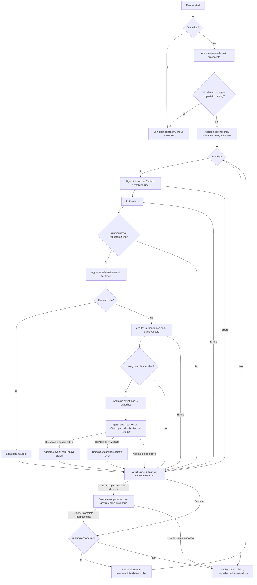

Il Monitor mantiene nomi conosciuti e copie degli ultimi stati/ATR.
Ad ogni ciclo apre un contesto, enumera i lettori, legge gli stati, attende fino
a 250 ms e rilascia il contesto; una pausa interrompibile di 250 ms separa i cicli.
I timeout attesi non diventano eventi error; gli altri errori, inclusi quelli di
cleanup, vengono emessi come `error`. Registrare sempre un listener.

Il loop ricontrolla `running` dopo l'enumerazione e dopo lo snapshot iniziale;
se e' stato fermato salta i passi successivi e dispone il contesto.
Un errore nello snapshot iniziale, anche un suo timeout, passa dal catch esterno:
soltanto il timeout della seconda attesa da 250 ms viene ignorato esplicitamente.
`start()` risolve dopo l'avvio del task, non dopo la disponibilita' del servizio.

### Confronto della baseline ed emissione degli eventi

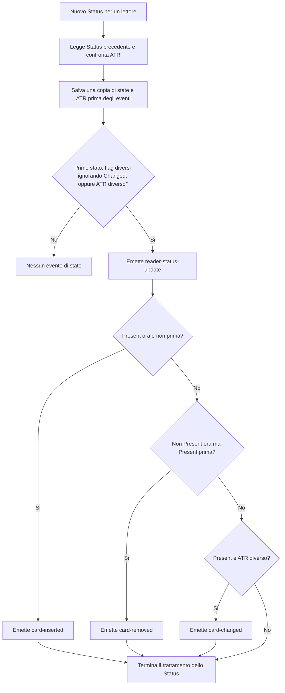

- nuovo lettore: reader-connected; rimosso: reader-disconnected;
- lista cambiata: readers-changed; lista vuota: no-readers;
- stato/ATR cambiato: reader-status-update;
- transizione absent/present: card-inserted oppure card-removed;
- carta ancora presente con ATR diverso: card-changed.

Changed viene ignorato nel confronto per evitare duplicati dovuti al solo flag
di notifica; il DTO conserva il valore nativo completo. Le copie interne sono
salvate prima di notificare i listener, per evitare mutazioni del baseline.
Non vengono ignorati altri bit, inclusi eventuali contatori nativi.
La sparizione di un lettore elimina la sua baseline ed emette reader-disconnected:
non sintetizza anche card-removed. `readers-changed` viene emesso soltanto se
l'insieme dei nomi cambia; il solo riordino della lista non lo provoca.

`start()` e' idempotente mentre attivo. `stop()` cambia immediatamente il flag
e interrompe la pausa, ma non chiama `Context.cancel`, non passa il controller
alla chiamata nativa e non chiude memoria usata da una chiamata pendente.
`close` segue il cleanup; asyncDispose aspetta la conclusione. Un nuovo start
aspetta l'arresto precedente. Il polling non garantisce di osservare transizioni
piu' brevi dell'intervallo.
La durata reale di stop non e' garantita entro 250 ms: comprende chiamate native,
attesa dei worker e cleanup. Se un listener error non esiste o un listener
lancia un'eccezione non gestita dal loop, il task puo' rigettare; il catch
installato da start rilancia l'errore in una microtask, senza ignorarlo.

Fonti: `Monitor.start`, `stop`, `#loop`, `#readers`, `#status`,
`Monitor[Symbol.asyncDispose]` in [monitor.ts](./src/monitor.ts);
`SmartCardEvents` in [types.ts](./src/types.ts).

## 9. ATR e compatibilita

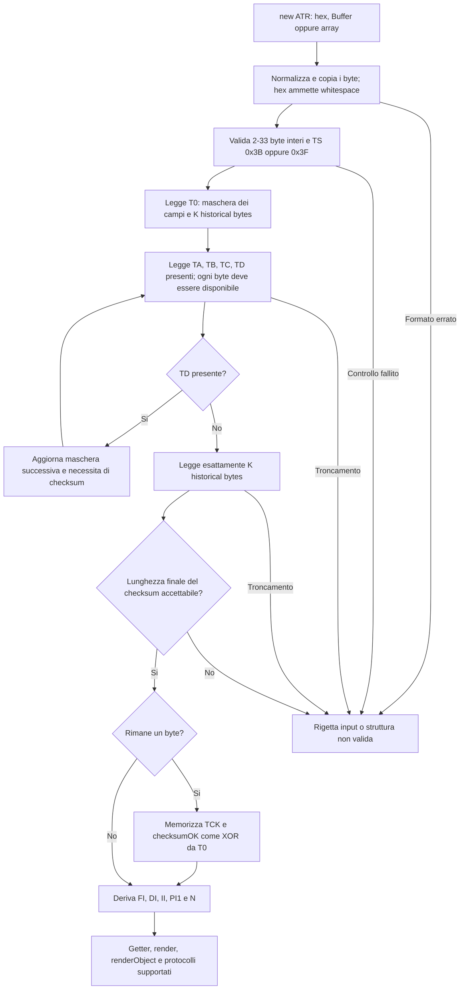

L'ATR conserva campi, tabelle, metodi e forma di renderObject del riferimento.
Accetta hex con whitespace, Buffer o array, di cui possiede una copia.
Valida byte, TS, disponibilita' degli interface bytes, numero di historical bytes
e lunghezza del checksum. Non puo' ciclare indefinitamente su una catena TD
troncata. Un checksum errato resta consultabile con checksumOK false.

Il codice richiede un byte TCK quando un TD dichiara un protocollo diverso da
T=0, e rifiuta piu' di un byte residuo. Accetta anche un singolo byte residuo
quando il checksum non e' richiesto: questo comportamento non va descritto
come validazione ISO completa. `hasChecksum` deriva dalla presenza del byte;
`checksumOK` resta null quando manca. Non c'e' negoziazione di protocollo,
accesso alla carta o parsing automatico dell'ATR ricevuto da status/Monitor.
Il limite del parser e' 33 byte, distinto dai 36 byte disponibili nella
struttura SCARD_READERSTATE Windows.

I test riprendono gli scenari ATR del riferimento e aggiungono input malformati.
La validazione piu' rigorosa e' una differenza intenzionale.

La compatibilita' non equivale al riuso dell'addon: versione e dipendenze native
sono diverse. `third_party` non e' replicato con versioni fittizie.
Le API amministrative/UI esclusivamente Windows sono fuori dal nucleo portabile.

Fonti: `ATR.constructor`, `getSupportedProtocols`, `render`, `renderObject`
in [atr.ts](./src/atr.ts); namespace e versione in
[index.ts](./src/index.ts), entry point di compatibilita in
[scard.ts](./src/scard.ts).

## 10. Verifica e pacchetto

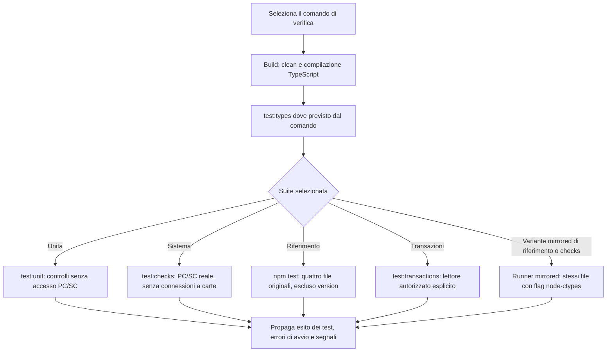

`test:unit` non esegue test:types. Il runner mirrored puo' essere invocato anche
direttamente, senza build o type-check automatici; con un percorso esplicito
puo' eseguire le regressioni hardware. Senza argomenti seleziona tests/src.

- `npm test`: build, test di tipi e suite originale node-scard, escluso version.
- `npm run test:mirrored`: stessa suite originale con NODE_CTYPES_NO_EXTERNAL_BUFFERS=1.
- `npm run test:unit`: solo controlli unitari aggiuntivi senza accesso PC/SC.
- `npm run test:checks`: build, tipi e controlli aggiuntivi in tests/checks.
- `npm run test:checks:mirrored`: stessi controlli aggiuntivi con buffer mirrored.
- `npm run test:transactions`: regressioni hardware in tests/hardware, con
  NODE_SMARTCARD_TEST_READER impostato al nome di un lettore autorizzato.
- Solo nei controlli tests/checks: servizio non avviato produce skip esplicito per
  no-service/service-stopped.
- Libreria mancante, errori inattesi e cleanup fallito: failure, non fallback.

Non ci sono fixture, mock o provider simulati nel progetto.
I quattro file tests/src/context.test.ts, card.test.ts, monitor.test.ts e
utils.test.ts riproducono esattamente il riferimento: cambiano solo import
del pacchetto e formattazione. Non ci sono gate o skip aggiunti nella suite
originale; version.test.ts non e' incluso.

La suite originale richiede un lettore e una carta reale autorizzata.
Conserva attese INFINITE, scelta del primo lettore/stato, connessione,
reconnect, stato e attributo ATR, GET CHALLENGE 00 84 00 00 20 con protocollo T1,
disconnect, release, asyncDispose, monitor di dieci secondi e quattro prove ATR.
Se mancano i lettori conserva anche il comportamento del test originale,
che accede al primo stato: non viene mascherato con uno skip.

I controlli aggiuntivi in tests/checks non si connettono alle carte, non inviano
APDU e non effettuano control/setAttribute.
La cancellazione usa la notifica PnP reale su Windows/Linux; quel test e' escluso
su macOS, dove non viene assunta la disponibilita' dello pseudo-reader.
Il test di carta originale non viene avviato automaticamente durante lo sviluppo
senza conferma dell'uso di una carta di test autorizzata.

Le regressioni in tests/hardware usano due connessioni condivise a una carta
reale per verificare la release con una transazione in attesa, e controllano
lo stato transazionale dopo reconnect secondo la piattaforma. Non inviano APDU
e non richiedono reset: usano LeaveCard. Se la chiusura supera il limite del
test, una chiamata low-level a SCardEndTransaction libera la transazione posseduta
dal test prima di attenderne il cleanup. L'assenza del nome del lettore genera
un errore esplicito, non uno skip. Questi test restano fuori da tests/checks
e dalla suite originale; il runner mirrored puo' eseguirli con il percorso
esplicito tests/hardware/transactions.test.ts.

La validazione locale Windows non certifica Linux/macOS. I modelli ABI sono
espliciti e verificati nei test di tipi/layout, ma occorre esecuzione sui sistemi
target e sui driver effettivi per attestare l'integrazione.

Il payload npm contiene dist, LICENSE e NOTICE oltre ai file standard npm:
test, esempi e sorgenti di sviluppo non sono parte del runtime distribuito.

Il [workflow fornito](./.github/workflows/ci.yml) e' predisposto per il pacchetto
come repository standalone: usa Node 24 su Windows, Linux e macOS ed esegue
build, tipi, unita', il controllo low-level con libreria PC/SC reale, le varianti
mirrored di unita' e low-level, e pack dry-run. Il controllo low-level verifica
anche gli export specifici della piattaforma e la configurazione errcheck;
se il servizio non e' avviato salta soltanto la prova di lifecycle che lo richiede.
Non esegue gli altri checks di sistema, la suite originale o transazioni hardware.
Nella collocazione attuale sotto
projects, non e' un workflow della directory .github del repository principale.

Fonti: [package.json](./package.json),
[test-mirrored.ts](./scripts/test-mirrored.ts),
[tests/src](./tests/src), [tests/checks](./tests/checks),
[transactions.test.ts](./tests/hardware/transactions.test.ts).

## Riferimenti al codice

| Flusso                          | Implementazione e simboli da seguire                                                                                                                                                                                        |
| ------------------------------- | --------------------------------------------------------------------------------------------------------------------------------------------------------------------------------------------------------------------------- |
| Export e namespace              | `scard`, `smartcard`, `Delay`, `version` in [index.ts](./src/index.ts); re-export in [scard.ts](./src/scard.ts)                                                                                                             |
| ABI, stringhe e costanti native | `createTypes` in [types.ts](./src/low-level/types.ts); `platformConstants`, `currentPlatform`, `SCARD_CTL_CODE` in [constants.ts](./src/low-level/constants.ts)                                                             |
| Caricamento e firme             | `defaultLibraryPath`, `bind`, `Native.constructor`, `Native.close` in [native.ts](./src/low-level/native.ts)                                                                                                                |
| Codici di ritorno               | `resultCode`, `checkResult`, `SCardError` in [errors.ts](./src/low-level/errors.ts)                                                                                                                                         |
| Registri e ownership pubblici   | `contextEntry`, `cardEntry`, `Context.establish`, `Context.release`, `Context[Symbol.asyncDispose]` in [runtime.ts](./src/runtime.ts)                                                                                       |
| Code e lifecycle delle risorse  | `enqueue`, `runContext`, `runCard`, `assertContext`, `Context.release`, `Card.disconnect` in [resources.ts](./src/resources.ts)                                                                                             |
| Lettori, attese e cancellazione | `Context.getStatusChange` in [runtime.ts](./src/runtime.ts); `Context.listReaders`, `waitForChange`, `cancel` in [resources.ts](./src/resources.ts)                                                                         |
| Carte, transazioni e comandi    | `Card.connect`, `reconnect`, `status`, `getAttribute`, `setAttribute`, `transmit`, `control`, `beginTransaction`, `endTransaction` in [resources.ts](./src/resources.ts); facciata `Card` in [runtime.ts](./src/runtime.ts) |
| Memoria e conversioni           | `inputBytes`, `capacity`, `returnedLength`, `text`, `multiString`, `statusNames`, `readBuffer` in [buffers.ts](./src/buffers.ts)                                                                                            |
| Nomi di stato e protocollo      | `stateName`, `protocolName` in [constants.ts](./src/constants.ts); DTO ed eventi in [types.ts](./src/types.ts)                                                                                                              |
| Monitor                         | `start`, `stop`, `#loop`, `#readers`, `#status`, `Symbol.asyncDispose` in [monitor.ts](./src/monitor.ts)                                                                                                                    |
| ATR                             | `ATR.constructor`, `getSupportedProtocols`, `render`, `renderObject` in [atr.ts](./src/atr.ts)                                                                                                                              |
| Test e modalita' mirrored       | Script in [package.json](./package.json), [test-mirrored.ts](./scripts/test-mirrored.ts), [regressioni hardware](./tests/hardware/transactions.test.ts)                                                                     |
